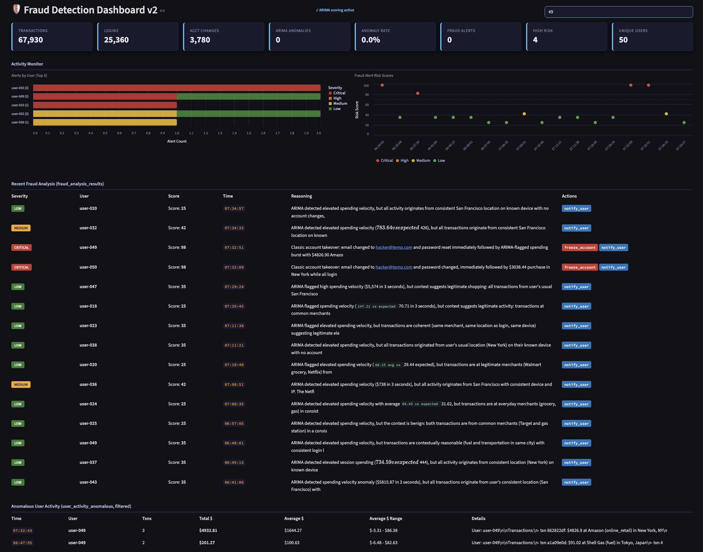
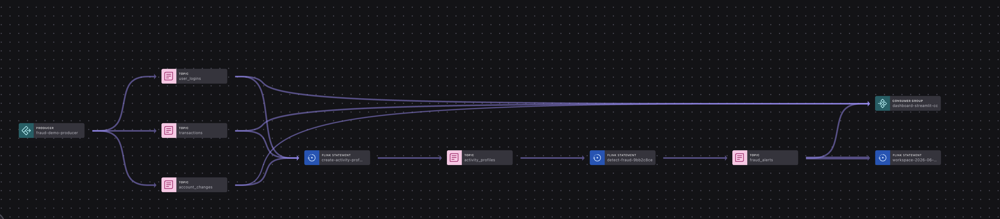

# Real-Time Fraud Detection with Confluent Intelligence Streaming Agents

[](https://www.confluent.io/get-started/)

<div align="center">
  
</div>

Build a real-time fraud detection system with [Confluent Cloud Streaming Agents](https://docs.confluent.io/cloud/current/ai/streaming-agents/overview.html). Streaming user activity is windowed and statistically scored (ARIMA) with **Confluent Cloud for Apache Flink**, and the anomalous activity is analyzed by a **Streaming Agent** (Confluent Intelligence) backed by **AWS Bedrock (Claude)**, which reasons over each user's behavior, calls tools, and emits fraud verdicts in real time. A local Python producer generates synthetic events, a local fraud-trigger web UI injects fraud on demand, and a local Streamlit dashboard visualizes the results.

Everything except the producer, fraud trigger, and dashboard runs in Confluent Cloud — there is no local Kafka or Flink.

<table>
<tr>
<th width="25%">Stage</th>
<th width="75%">What happens</th>
</tr>
<tr>
<td><strong>1 · Ingest</strong></td>
<td>A producer streams synthetic <code>transactions</code>, <code>user_logins</code>, and <code>account_changes</code> (~80% normal, ~20% fraud: geo-impossible travel, account takeover, velocity).</td>
</tr>
<tr>
<td><strong>2 · Window &amp; score</strong></td>
<td>Flink SQL <code>UNION ALL</code>s the three streams, keys by <code>user_id</code>, and collects each user's activity into a 3-second event-time <code>SESSION</code> window — one clean profile per activity burst. <code>ML_DETECT_ANOMALIES</code> (ARIMA) scores each session's average transaction amount against that user's own history (<code>user_activity_scored</code>).</td>
</tr>
<tr>
<td><strong>3 · Filter</strong></td>
<td>Only sessions whose spend is statistically above the user's norm are kept (<code>user_activity_anomalous</code>) and enriched with the ARIMA context (<code>user_activity_anomalous_enriched</code>), so the agent only sees activity worth a closer look.</td>
</tr>
<tr>
<td><strong>4 · Reason &amp; act</strong></td>
<td><code>AI_RUN_AGENT</code> runs a <code>CREATE AGENT</code> Streaming Agent (Bedrock Claude) over each profile. It scores the activity and calls function tools — <code>flag_transaction</code>, <code>freeze_account</code>, <code>notify_user</code> — during its reasoning.</td>
</tr>
<tr>
<td><strong>5 · Alert</strong></td>
<td>The agent's JSON verdict (risk score, reasoning, actions, flagged ids) is written to the <code>fraud_analysis_results</code> topic and rendered live on the Streamlit dashboard.</td>
</tr>
</table>



## Prerequisites

**Required accounts & credentials:**

- **A Confluent Cloud account** + a **Cloud resource management** API key & secret ([create one](https://docs.confluent.io/cloud/current/security/authenticate/workload-identities/service-accounts/api-keys/manage-api-keys.html)).
  [](https://www.confluent.io/get-started/)
- **An AWS account with Amazon Bedrock access** — an IAM user with a long-lived access key & secret and the `bedrock:InvokeModel` permission.
- **Claude model access enabled in Amazon Bedrock** (region **`us-east-1`**). Bedrock does **not** enable third-party models by default — you must request/enable access to Anthropic Claude on the **Model access** page once. See [Add or remove access to Amazon Bedrock foundation models](https://docs.aws.amazon.com/bedrock/latest/userguide/model-access.html). Without this, deploy succeeds but no alerts are produced (Bedrock returns AccessDenied).

**Required tools:**

- **[Terraform](https://github.com/hashicorp/terraform)**
- **[Git](https://git-scm.com/)**
- **[Python 3.11+](https://www.python.org/downloads/)**

<details>
<summary>Installation commands (Mac / Windows)</summary>

**Mac (Homebrew):**

```bash
brew install git python && brew tap hashicorp/tap && brew install hashicorp/tap/terraform
```

**Windows (winget, PowerShell):**

```powershell
winget install Git.Git Python.Python.3.12 Hashicorp.Terraform
```

**Optional — maintainers only, to rebuild the UDF JAR:**

```bash
# Mac
brew install colima docker && colima start
```
```powershell
# Windows
winget install Docker.DockerDesktop
```
</details>

## 🚀 Quick Start

**1. Clone the repository:**

```bash
git clone https://github.com/confluentinc/demo-confluent-fraud-agent.git && cd demo-confluent-fraud-agent
```

**2. Provide your four credentials:**

```bash
cd terraform
cp terraform.tfvars.example terraform.tfvars
# edit terraform.tfvars — Confluent Cloud key/secret + AWS Bedrock IAM key/secret
```

These four values are the **only** inputs. Region (`us-east-1`), the Claude model, resource names, and sizing are all preset.

**3. One-command deployment:**

```bash
terraform init && terraform apply
```

This provisions everything — environment, Kafka cluster, Schema Registry, Flink compute pool, the Bedrock connection, the model, the UDF tools (JAR upload + functions + tools), the agent, and the four materialized tables that make up the pipeline — and writes a ready-to-use `.env` for the local apps.

**4. Install the Python dependencies:**

<details open>
<summary>macOS / Linux</summary>

```bash
cd .. && python3 -m venv venv && source venv/bin/activate && pip install -r requirements.txt
```
</details>

<details>
<summary>Windows (PowerShell)</summary>

```powershell
cd .. ; python -m venv venv ; venv\Scripts\Activate.ps1 ; pip install -r requirements.txt
```
</details>

**5. Start the producer** — in one terminal, generate events:

```bash
python producer/generate_events.py --both
```

`--both` generates normal activity and starts injecting fraud after cycle 50. (The default mode generates normal activity only; `--fraud` generates fraud only; `--single-fraud` sends one fraud event and exits.)

**6. Start the dashboard** — in a **second** terminal, launch the UI at http://localhost:8501:

```bash
streamlit run dashboard/app.py
```

> Activate the virtual environment in each new terminal first (`source venv/bin/activate`, or `venv\Scripts\Activate.ps1` on Windows).

Or run everything (producer, fraud trigger on :8080, and dashboard on :8501) in the background with `./start-all.sh --both`; see [RUNNING.md](RUNNING.md).

That's it! Watch fraud verdicts appear in real time — the injected scenarios surface as high-risk results (scores ~75–95) with `freeze_account` / `flag_transaction` actions and the flagged transaction ids.

> [!NOTE]
> **ARIMA needs history.** The detector needs at least 50 activity sessions per user before it flags anything, so expect the first verdicts a few minutes after the producer starts (the dashboard shows "ARIMA scoring pending: not enough history" until then). The dashboard also reads from `latest`, so keep the producer running and allow time for the first window-firing batch. You can also inspect the running statements and tables in the [Flink workspace](https://confluent.cloud/go/flink).

## Online Hosting

For reliability for public demos, the 'Fraud Trigger', 'Fraud Detection' Dashboard, and transaction generators can be hosted remotely (for example, on a cloud-hosted VM).

Architecture:
* Fraud Trigger should be exposed on the Internet (so attendees can trigger 'fraud')
* Transaction generator can be run on a cloud VM for more reliable network connectivity to the Kafka cluster (good for conference center wifi)
* The dashboard can be run on a cloud VM, but should only be exposed directly to the workstation

Directions:

1. Run the lab terraform from local workstation to deploy infrastructure. This will generate a `.env` file in the project directory that has credentials needed for the cloud-hosted VM

1. Provision a cloud VM (e.g. an EC2 instance in the same region as the Confluent Cloud cluster)

1. Set up networking so the cloud VM can be accessed by conference attenddes (e.g. expose port 8080 on the VM via an ALB)

1. On the cloud VM:
    1. Install pip and venv. For example, on Ubuntu: 
    
        ```shell
        sudo apt-get update
        sudo apt-get install -y python3-pip python3-venv
        ```

    1. Clone the git repo

        ```shell
        git clone https://github.com/justinrlee/demo-confluent-fraud-agent
        cd demo-confluent-fraud-agent
        ```

    1. Copy the `.env` file from the workstation used to provision the Confluent Cloud resources to the base of the repo on the cloud VM. It should look something like this:

        ```shell
        ubuntu@ip-10-32-1-20:~/demo-confluent-fraud-agent$ cat .env
        # Generated by Terraform — do not edit by hand. Re-run `terraform apply` to refresh.
        BOOTSTRAP_SERVERS=pkc-312o0.ap-southeast-1.aws.confluent.cloud:9092
        KAFKA_API_KEY=ABCD1234ABCD1234
        KAFKA_API_SECRET=cflta1405f930218b3331e326507958e218b70defcfec795ca2bb399694755ea
        SCHEMA_REGISTRY_URL=https://psrc-7yzmzo.ap-southeast-1.aws.confluent.cloud
        SCHEMA_REGISTRY_API_KEY=ABCD1234ABCD1234
        SCHEMA_REGISTRY_API_SECRET=cflt03b3db840278061f1a20e931d30291b2e68d0e5a25d612911c7cbfdde456
        ```
    1. In the repo, initialize and activate a virtual Python environment (called `venv` for this example), then install the Python requirements:
    
        ```shell
        python3 -m venv venv
        source venv/bin/activate

        python3 -m pip install -r requirements.txt
        ```

    1. Start the three services:

        ```shell
        ./start-all.sh
        ```

1. You should be able to look at logs for individual services in the `run` directory (in the project root)

Notes:
* The dashboard will be exposed on the VM on port 8501 (networking is left as an exercise to the reader)
* The fraud trigger will be exposed on the VM on port 8080 (again, networking is left as an exercise)


## 🎬 Demo walkthrough

Deployed and running? Follow the **[guided demo walkthrough → `demo.md`](demo.md)** — a ~15-minute, screenshot-by-screenshot script that traces the pipeline through **Stream Lineage** (source topics → windowing & ARIMA scoring → the Flink Streaming Agent with tools & AI agent → the verdicts topic) and finishes on the live dashboard.

## Directory Structure

```
demo-confluent-fraud-agent/
├── terraform/                       # One-step Confluent Cloud provisioning (start here)
│   ├── main.tf                      # Env, cluster, SR, compute pool, service account, keys, ACLs
│   ├── flink.tf                     # Bedrock connection, tools artifact, source tables, the 4 materialized tables, model/tools/agent
│   ├── flink_archive.tf             # Commented-out legacy pipeline (reference only)
│   ├── connect.tf                   # Writes .env for the local apps
│   ├── variables.tf                 # Inputs: credentials, identifier, region, Bedrock model id
│   └── modules/flink-statement/     # Reusable confluent_flink_statement wrapper
├── tools-udf/                       # Java UDF tools (flag/freeze/notify) + pre-built JAR
├── producer/generate_events.py      # Synthetic event generator (Confluent Cloud)
├── producer/generate_events_local.py # WIP: variant for a local/self-managed Kafka cluster, not yet supported
├── fraud-trigger/                   # Web UI (port 8080) to trigger fraud scenarios on demand
├── dashboard/app.py                 # Streamlit real-time dashboard
├── start-all.sh, stop-all.sh, status.sh  # Run/manage the local apps in the background (see RUNNING.md)
└── requirements.txt                 # Local app dependencies
```

## How the agent's tools work

The agent calls three function-based tools — `flag_transaction`, `freeze_account`, `notify_user` — implemented as Flink UDFs in `tools-udf/` and uploaded as a Flink artifact. They are **mock** actions (each returns a confirmation string, no real side effect) but are genuinely invoked by the agent during tool-calling. To change them, edit the Java sources and rebuild with `tools-udf/build.sh` (uses Docker — no host Java toolchain needed), then commit the new JAR. Rebuilding is a maintainer task; running the demo never requires it.

## Troubleshooting

**Dashboard shows no fraud results?** The input topics and `user_activity_scored` fill but `fraud_analysis_results` stays empty — check, in order:

1. **Bedrock model access.** If Claude isn't enabled in **Amazon Bedrock → Model access (us-east-1)**, every `AI_RUN_AGENT` call fails with AccessDenied and no results are produced. Enable it (see Prerequisites).
2. **Has ARIMA built a baseline, and is the `fraud_analysis_results` statement RUNNING?** `user_activity_anomalous` stays empty until each user has ≥50 sessions *and* a spending spike occurs (run the producer with `--both` or use the fraud trigger). In the [Flink workspace](https://confluent.cloud/go/flink), check the `fraud_analysis_results` statement isn't `FAILED`. The agent is configured with `handle_exception = 'continue'` and `max_consecutive_failures = '5'` so a stray malformed model response doesn't kill it — if it still fails, inspect the statement's error detail.
3. **Give it a few minutes** with the producer running. The dashboard reads from `latest`; results arrive in window-firing batches.

Verify the stages directly in the Flink workspace:
```sql
SELECT * FROM user_activity_scored;                 -- should fill (windowing + ARIMA work)
SELECT * FROM user_activity_anomalous;              -- sessions ARIMA flagged as unusually high spend
SELECT * FROM fraud_analysis_results WHERE risk_score >= 70;   -- the high-risk verdicts
```

## Cleanup

```bash
cd terraform && terraform destroy
```

This removes the entire Confluent Cloud environment (cluster, topics, schemas, Flink resources) in one step.

## Sign up for early access to Flink AI features

For early access to new Flink AI features, [fill out this form](https://events.confluent.io/early-access-flink-features) and we'll add you to our early access previews.
