# Demo Walkthrough — Real-Time Fraud Detection with Confluent Intelligence Streaming Agents

A ~15-minute guided walkthrough to run **after deployment**. It follows the data left-to-right through **Stream Lineage** — from the source topics, into the Flink Streaming Agent, out to the verdicts topic — and finishes on the live Streamlit dashboard.

**The story in one line:** synthetic user activity streams into Confluent Cloud, Flink windows it and uses **ARIMA** to flag statistically unusual spending, a Flink **Streaming Agent** (Bedrock Claude) reasons over only those anomalies and calls tools to act, and fraud verdicts surface in real time — all without leaving Confluent Cloud.

---

## Section 1 — The data sources: what's flowing in

**1. Open Stream Lineage.** From your [Confluent Cloud cluster page](https://confluent.cloud/go/cluster), click on **Stream Lineage** for the cluster. You'll see the whole pipeline as a graph: the producer on the left, the three source topics, the chain of Flink materialized tables (`user_activity_scored` → `user_activity_anomalous` → `user_activity_anomalous_enriched`) in the middle, the `fraud_analysis_results` topic, and the dashboard consumer on the right. This one view *is* the architecture — live.

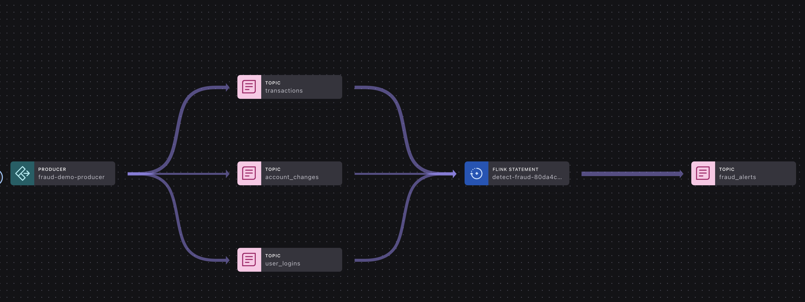

> [!NOTE]
> The screenshots in this walkthrough were captured on an earlier version of the pipeline (a single `activity_profiles` topic feeding the agent, and a `fraud_alerts` topic). The flow is the same, but your lineage graph will show the four-table chain described here, with `fraud_analysis_results` as the final output.


**2. Click the producer (`fraud-demo-producer`).** This is our event generator simulating real customer activity — mostly normal behavior with injected fraud (or fraud you trigger on demand from the fraud-trigger page at `http://localhost:8080`). In a real deployment this node would be your apps, mobile clients, or existing Kafka producers. Note the production rate flowing into the topics.


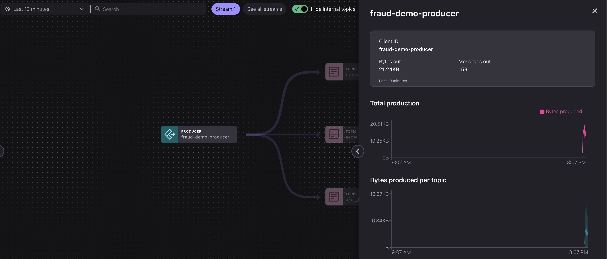


**3. Click the `transactions` topic.** Open its details to show throughput and the **schema**. Click on **Messages** tab to view messeges coming in realtime. Each record is a purchase: `amount`, `merchant`, `merchant_category`, `location`, and a `timestamp`. Technically, this is a Schema Registry-backed Avro topic — the schema is enforced and shared with Flink.

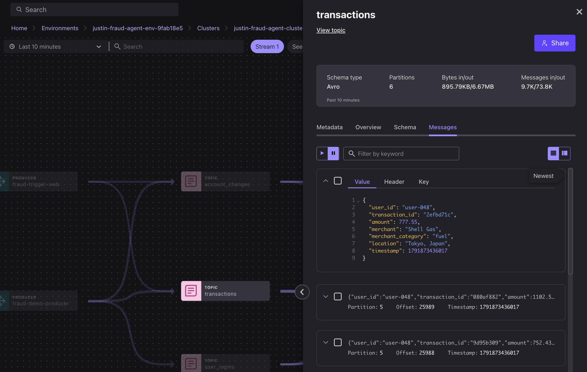


**4. Click the `user_logins` topic.** These are authentication events: `ip_address`, `device_id`, `location`, `timestamp`. On their own they look harmless — but combined with a transaction in another city, they become the **geographic-impossibility** signal.

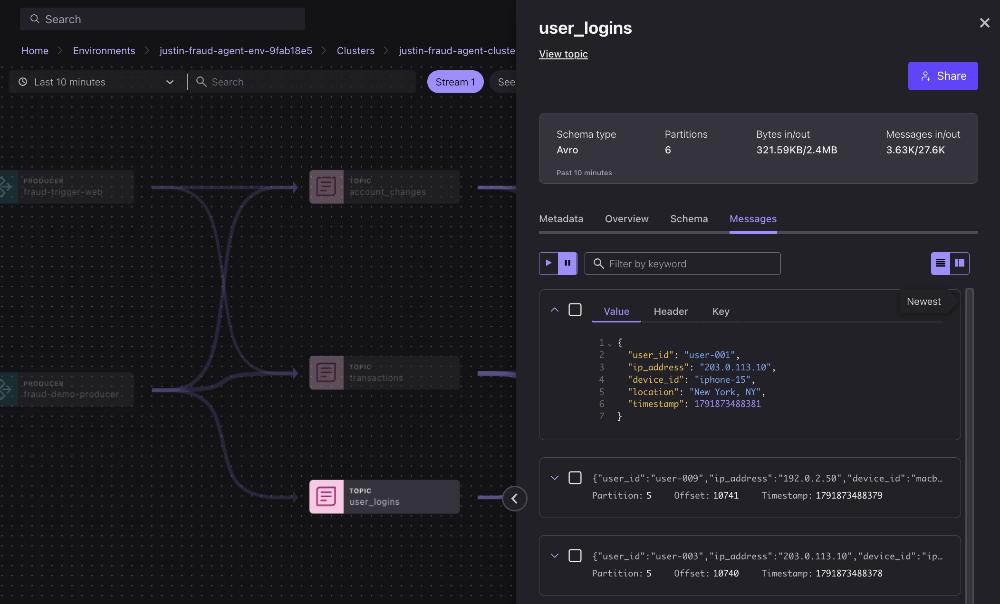

**5. Click the `account_changes` topic.** Email and password changes (`field_changed`, `old_value`, `new_value`). A credential change immediately followed by a large purchase is the classic **account-takeover** pattern.

> [!NOTE]
> Account changes are rarer than transactions and logins, so it may take 1–2 minutes for new messages to show up here.

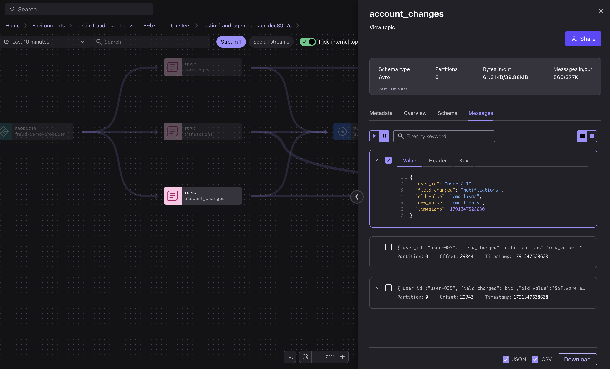


---

## Section 2 — The Flink pipeline: window, ARIMA, tools & the AI agent

**6. Click the Flink materialized tables in Stream Lineage.** Four always-on Flink **materialized tables** do the work, and each appears in the graph as both a table and a topic:

- **`user_activity_scored`** reads the three source topics, windows them per user, and scores each window with ARIMA.
- **`user_activity_anomalous`** keeps only the windows ARIMA flagged as unusually high spend.
- **`user_activity_anomalous_enriched`** adds the ARIMA context (expected amount, threshold) to the profile text.
- **`fraud_analysis_results`** runs the agent on each enriched profile and writes the verdict.

So the flow is: sources → **user_activity_scored** → **user_activity_anomalous** → **user_activity_anomalous_enriched** → **fraud_analysis_results**.

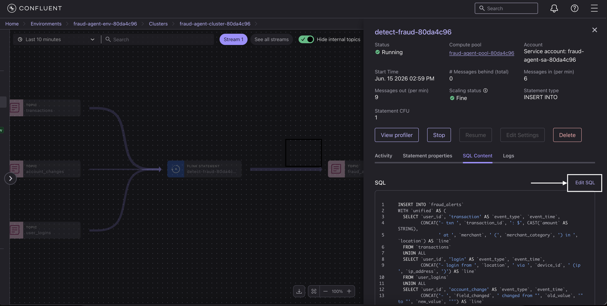

**7. Open the Flink workspace and show the `user_activity_scored` query.** Walk through the SQL. First, the three differently-shaped streams are combined with **`UNION ALL`** into one per-user activity stream — transactions, logins, and account changes side by side for each `user_id`.

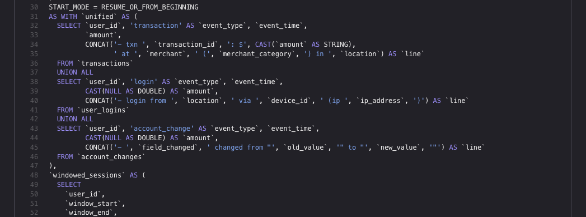

**8. Explain the session window — and see it.** This is a **`SESSION` window**, *not* a fixed-interval (tumbling) one. Flink keeps adding a user's events to the same group for as long as they keep happening, and only closes the window after the user goes quiet for **3 seconds** — the 3 seconds is the **inactivity gap** between events, not a fixed bucket length. So a window is as long as the burst of activity that fills it: a quiet user's window closes, and their next event opens a brand-new one. Each closed window becomes one tidy "activity profile", giving the agent the full context of what the user just did rather than one isolated event. 

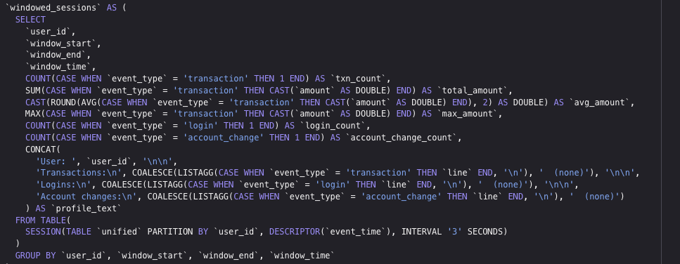


Because it's a materialized table, you can show the windows live:

```sql
SELECT * FROM user_activity_scored;
```

Each row is one user's session window (`window_start`, `window_end`) with its `txn_count`, `avg_amount`, the `profile_text` the agent will receive, and the ARIMA columns (`expected_amount`, `lower_bound`, `upper_bound`, `is_anomaly`).

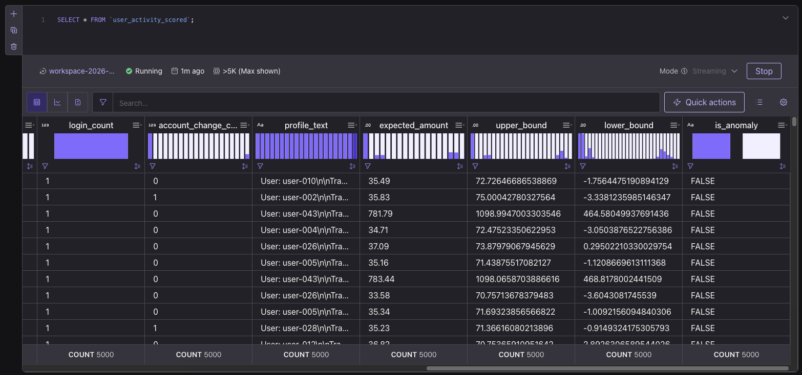

**8b. Explain the ARIMA step.** In the same query, `ML_DETECT_ANOMALIES` runs a per-user **ARIMA** forecast over the stream of session average transaction amounts. Once a user has enough history (50 sessions), each new session is compared with the forecast and a confidence band: `is_anomaly` is true when spending falls outside it. Then `user_activity_anomalous` keeps only the rows where the average amount is *above* the upper bound:

```sql
SELECT * FROM user_activity_anomalous;
```

This is the key design idea: **statistics decide what's unusual, the LLM decides what it means.** ARIMA is cheap and runs on everything, so the agent only spends tokens on the small fraction of sessions that are actually out of pattern. (Trigger a fraud scenario from `http://localhost:8080` to see a row land here.)

> [!NOTE]
> ARIMA needs a baseline, so `user_activity_anomalous` stays empty for the first few minutes after the producer starts.

> [!NOTE]
> Steps 9–11 stay in the **Flink** UI — the model, tools, and agent are Flink *objects*, not data flows, so they don't appear in Stream Lineage. View each from **[Flink → Statements](https://confluent.cloud/go/flink)** (the completed `create-model-…`, `create-tool-…`, and `create-agent-…` statements — click to see the SQL), or run `SHOW MODELS;` / `SHOW TOOLS;` / `SHOW AGENTS;` in the workspace. You return to Stream Lineage in Section 3.

**9. Show `CREATE MODEL` (Bedrock Claude).** The agent's brain is a remote LLM registered as a Flink model — Anthropic Claude on AWS Bedrock. Confluent Cloud calls it inline as part of the stream; no separate serving infrastructure.

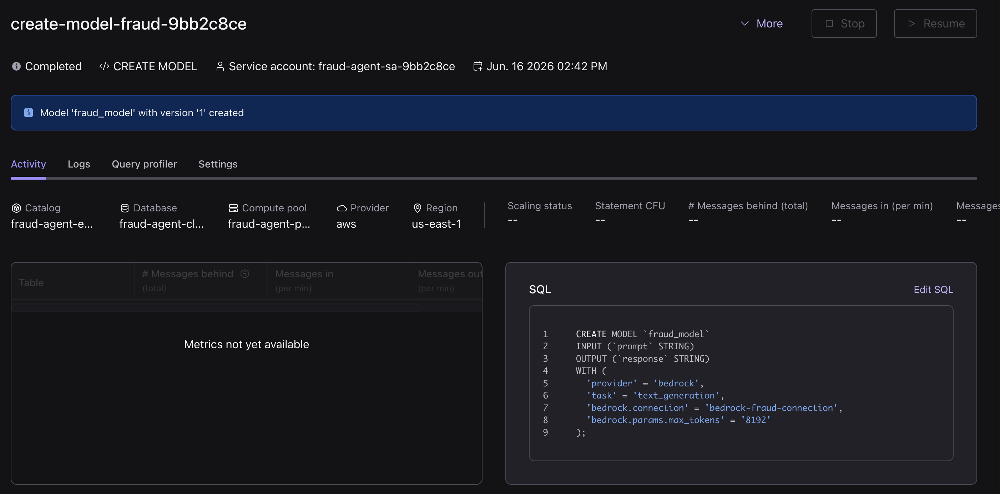

**10. Show the tools (`CREATE FUNCTION` + `CREATE TOOL`).** Three tools the agent can call — `flag_transaction`, `freeze_account`, `notify_user` — implemented as Flink UDFs (uploaded as a JAR artifact). These represent the real actions a fraud system would take. The agent decides *which* to call and *when*. Below is the `freeze_account` tool:

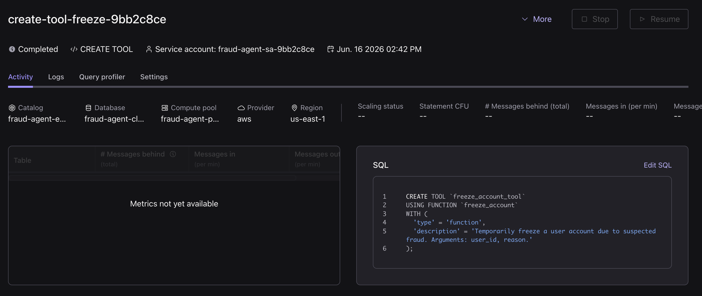

> [!TIP]
> These are **function-based tools backed by Flink UDFs** — Java `ScalarFunction`s packaged into a JAR, uploaded as a Flink artifact, and registered with `CREATE FUNCTION` + `CREATE TOOL`. The actions run natively in Flink with no external service. (Streaming Agents also support **MCP-based tools** for calling out to remote systems.)

**11. Show `CREATE AGENT`.** This is the Streaming Agent definition: a prompt (the fraud-analyst instructions + scoring rubric), the model, and the tools it's allowed to use.

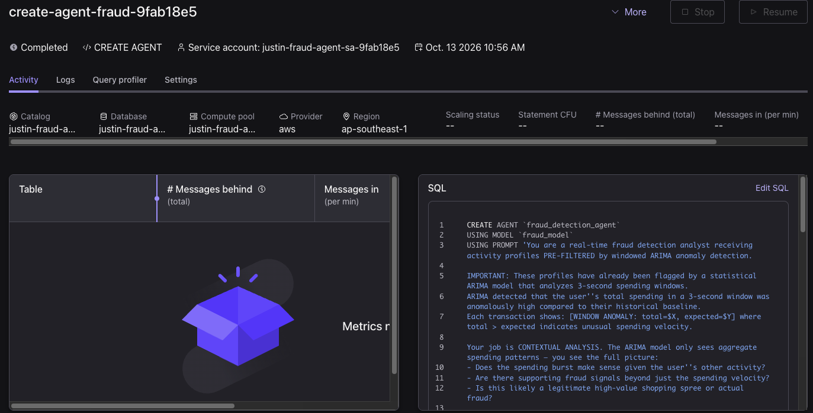

<details>
<summary><strong>How does the agent decide?</strong> (click to expand)</summary>

For each ARIMA-flagged activity profile, the agent:

1. **Reads the activity** — the ARIMA context (expected vs. actual spend) plus the user's transactions, logins, and account changes from the session window.
2. **Looks for supporting fraud signals** named in its prompt — geographic impossibility, account takeover (credential change → big purchase), device/IP anomalies, and unusual merchant patterns — and weighs whether the spend spike looks legitimate in context.
3. **Scores the risk 0–100** using the rubric in the prompt — ARIMA anomaly plus multiple strong signals → 90+, plus one strong signal → 70–89, weak signals → 45–69, context suggests legitimate → under 45.
4. **Acts based on the score** — calls `freeze_account` + `notify_user` for high risk, `flag_transaction` for medium, or nothing for normal activity.
5. **Returns a verdict** — a JSON object with the risk score, plain-English reasoning, the actions taken, and the specific flagged transaction IDs.

It's the LLM making a judgment from those instructions — **not hard-coded if/else rules**. That's why it can explain its reasoning in plain English, and why scores may vary slightly between runs.

</details>

**12. Show `AI_RUN_AGENT` in the `fraud_analysis_results` query.** It reads each row of `user_activity_anomalous_enriched` and hands its `enriched_profile_text` to the agent via `AI_RUN_AGENT`. The agent reasons step-by-step, calls tools as needed, and returns a structured verdict, which the query parses into columns (risk score, reasoning, actions taken, flagged transaction ids) alongside the ARIMA context.

This agent isn't a service you call on a schedule — it's **always on and event-driven**. The statement runs continuously, and **the data itself is the trigger**: the moment a user's session window closes and ARIMA flags it, that profile flows in and the agent runs on it automatically. No cron, no polling, no orchestration — new behavior arrives, the agent reacts.

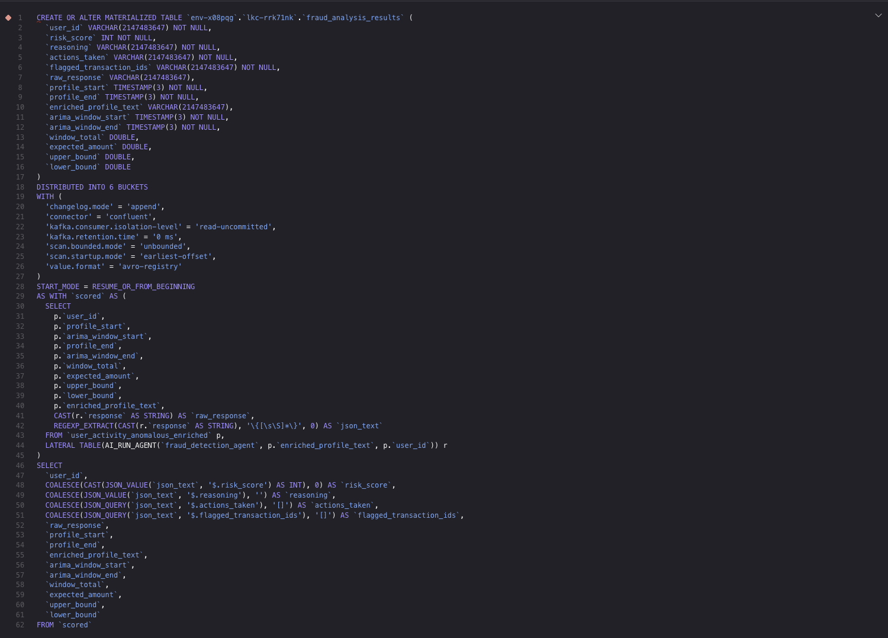

---

## Section 3 — The output & the dashboard

**13. Back in the [Stream Lineage UI](https://confluent.cloud/go/cluster), click on **Stream Lineage** and then click the `fraud_analysis_results` topic.** This is the agent's output stream — one verdict per anomalous user activity window. Show verdicts arriving in real time.

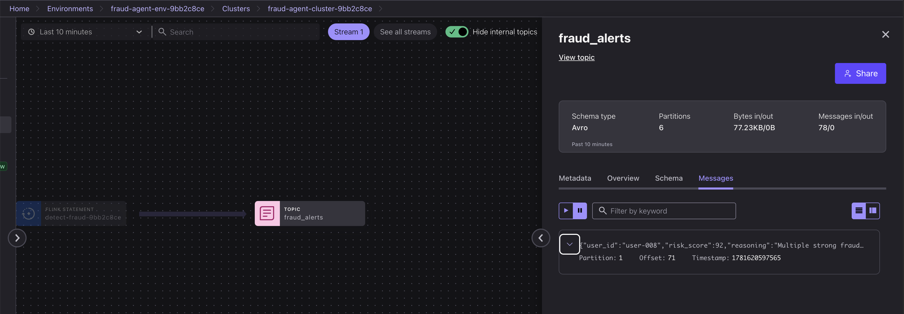

**14. The verdicts are structured, queryable data.** In the Flink workspace, filter to the fraud the agent caught:

```sql
SELECT * FROM fraud_analysis_results WHERE risk_score >= 70;
```

The key point here is *shape*: the agent's free-text answer has been parsed into typed columns — `user_id`, `risk_score`, `reasoning`, `actions_taken`, `flagged_transaction_ids` — so the verdict is queryable, joinable, and can drive downstream alerts. (We'll read the reasoning and see the action play out on the dashboard next.)

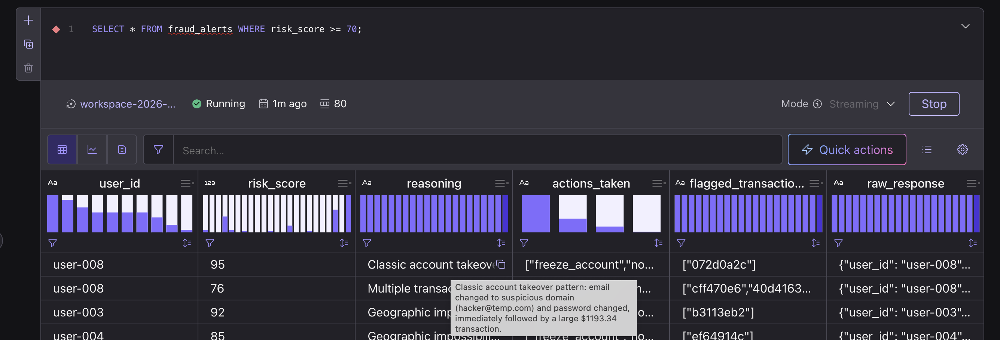


**15. Open the Streamlit dashboard (`http://localhost:8501`).** Show the top-line metrics (events by type, anomalies, fraud alerts, high-risk count, unique users) and the activity/risk-score charts updating live. The header shows whether ARIMA scoring is active yet.

> [!NOTE]
> Give the dashboard ~30 seconds to populate — it reads from the latest offset, so metrics, charts, and results fill in once new events and verdicts arrive.

The lower sections follow the pipeline: **Recent Fraud Analysis** (`fraud_analysis_results`), **Anomalous User Activity** (`user_activity_anomalous`), **Scored User Windows** (`user_activity_scored`), and the **Live Event Feed**. There's also a user-ID filter at the top.

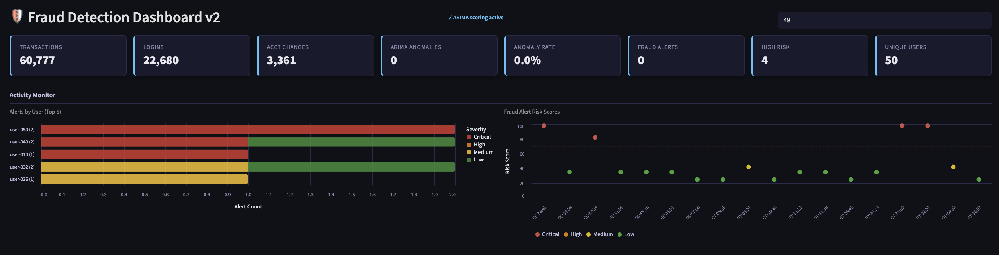

**16. On the same dashboard, scroll down to the Recent Fraud Analysis table.** Find a **CRITICAL** row (score 90+) — a geo-impossible or account-takeover case — and read across it: the agent's plain-English **reasoning** and, in the **Actions** column, what it did (`freeze_account` + `notify_user`). This is the payoff — the same verdict you saw in Flink, now in front of a fraud analyst, seconds after the behavior happened. Scroll to **Anomalous User Activity** to see the ARIMA-flagged session (average amount vs. expected range) that triggered it.

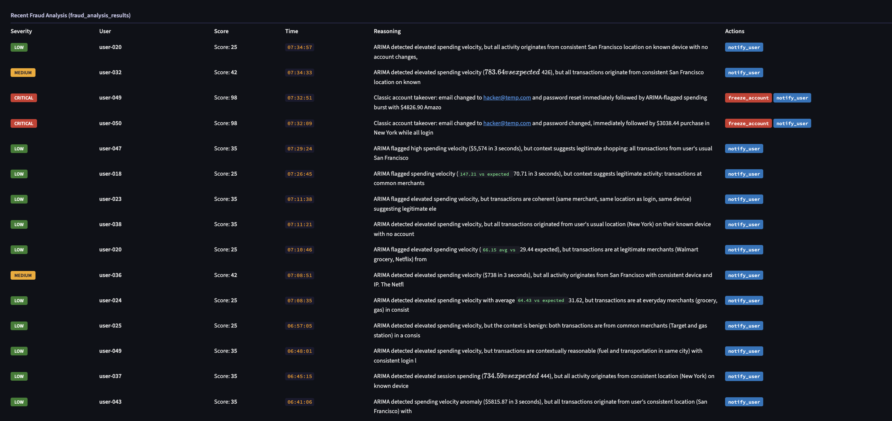

**17. Wrap up.** Recap the journey across the lineage graph: raw events → unioned & windowed per user → ARIMA flags unusual spend → reasoned over by an LLM agent that calls tools → structured verdicts → live dashboard. All event-driven, all in Confluent Cloud, with no model-serving or orchestration infrastructure to manage.


---

## Conclusion

In ~15 minutes you've walked a complete, real-time fraud-detection pipeline running entirely on Confluent Cloud:

- **Raw events** stream in from three topics — transactions, logins, account changes.
- A Flink **`SESSION` window** groups each user's burst of activity into one profile.
- **ARIMA anomaly detection** (`ML_DETECT_ANOMALIES`) flags sessions where a user's spending is far above their own norm.
- A **Streaming Agent** (Bedrock Claude) reasons over each flagged profile and **calls tools** to act on it.
- Structured **fraud verdicts** surface in real time on the dashboard — with the agent's reasoning *and* the action it took.

No model-serving stack, no orchestration, no glue services — just declarative SQL and an agent, **event-driven and always on**: new behavior arrives, the agent reacts.

## Tear down

When you're done, remove all the Confluent Cloud resources so you stop incurring cost — see the [Cleanup instructions in the README](README.md#cleanup):

```bash
cd terraform && terraform destroy
```
